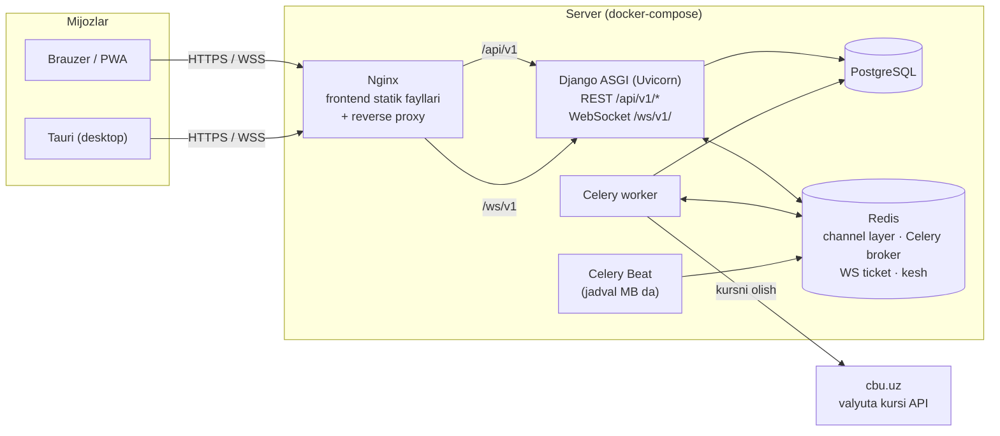
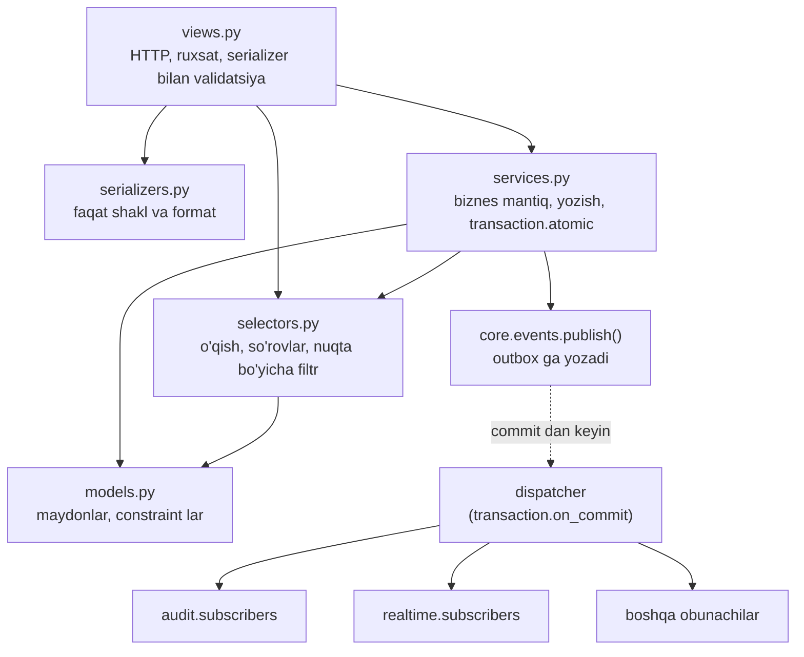
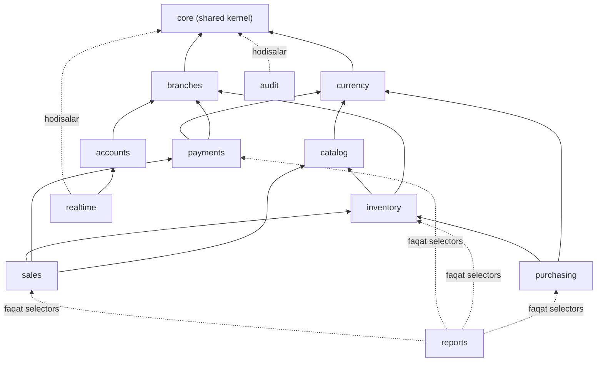
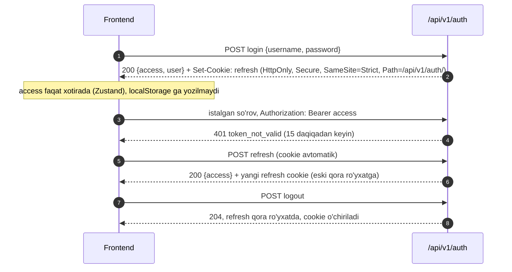

# Arxitektura (backend)

> Holat: 1-bosqich amalga oshirildi (`config/`, `core/`, `apps/accounts`, `apps/branches`, `apps/audit`).
> Rejadan farqlar: (1) `OutboxEvent` so'rov kontekstini (`request_id`, `ip`, `user_agent`) ham saqlaydi —
> audit Celery orqali qayta tarqatilganda ham to'g'ri yoziladi; (2) `HasCapability` ViewSet da
> `capability_map` bilan ishlaydi, ro'yxatda bo'lmagan action rad etiladi (`"*"` — hammasi uchun);
> (3) sozlama ta'riflari har app ning `settings_defs.py` faylida ro'yxatga olinadi (`core.settings_registry`);
> (4) DRF ning o'z xabarlari `LANGUAGE_CODE="uz"` bilan allaqachon o'zbekcha.

## 1. Umumiy ko'rinish



- Frontend va backend **bitta domen** ostida (Nginx orqali) ishlaydi: `/` — frontend, `/api/v1/` va `/ws/v1/` — backend.
  Shu sababli refresh cookie `SameSite=Strict` bo'la oladi va CORS kerak bo'lmaydi. Dev rejimida xuddi shu ishni Vite proxy bajaradi.
- Celery worker ham domen hodisalarini chiqaradi (masalan kurs yangilandi) — ular Redis channel layer orqali WebSocket ga yetadi.
- Ma'lumot manbai doimo PostgreSQL. WebSocket faqat "nimadir o'zgardi" degan bildirishnoma kanali.

## 2. Repozitoriyalar

Spec da monorepo (`backend/`, `frontend/`, `docs/`, `docker-compose.yml`) ko'rsatilgan, lekin loyiha uchun **ikkita alohida repo** ochilgan.
Front va back baribir "mutlaqo alohida loyihalar" bo'lgani uchun quyidagicha moslashtiraman:

| Monorepo dagi joy | Hozirgi joy |
|---|---|
| `backend/` | `sevento_back` repo ildizi |
| `frontend/` | `sevento_front` repo ildizi |
| `docs/` (umumiy: arxitektura, ER, API, realtime) | `sevento_back/docs/` |
| `docs/` (frontend ga xos) | `sevento_front/docs/` |
| `docker-compose.yml` | `sevento_back/docker-compose.yml` (frontend servisi `../sevento_front` dan build qilinadi, yo'l `FRONTEND_DIR` bilan o'zgartiriladi) |
| `README.md` | ikkala repoda: har biri o'z qismini yoritadi, back README umumiy ishga tushirishni ko'rsatadi |

Lokal ish papkasi:

```
workspace/
├── sevento_back/    # docker compose up shu yerdan
└── sevento_front/
```

OpenAPI sxema backend repoda `docs/api/openapi.yaml` sifatida saqlanadi (CI da yangiligi tekshiriladi).
Frontend `npm run gen:api` bilan shu fayldan (yoki ishlayotgan backend `/api/v1/schema/` dan) TypeScript turlarini generatsiya qiladi.

## 3. Backend papka tuzilishi

```
sevento_back/
├── config/
│   ├── settings/
│   │   ├── base.py          # umumiy sozlamalar, hammasi env dan
│   │   ├── dev.py
│   │   ├── prod.py
│   │   └── test.py
│   ├── urls.py              # /api/v1/ , /admin/ , schema
│   ├── api_v1.py            # barcha app url larini /api/v1/ ostida yig'adi
│   ├── asgi.py              # HTTP + WebSocket routing
│   ├── wsgi.py
│   └── celery.py
├── core/                    # umumiy yadro (shared kernel) — biznes mantiq YO'Q
│   ├── events/              # Event, publish(), subscribe(), dispatcher, outbox
│   ├── api/                 # xato formati, pagination, filter bazasi, idempotency
│   ├── models.py            # TimeStampedModel, OutboxEvent, SystemSetting, DocumentSequence, IdempotencyRecord
│   ├── money.py             # Decimal yordamchilari, yaxlitlash
│   ├── numbering.py         # hujjat raqamlari (S-TSH1-26-000123)
│   ├── settings_service.py  # SystemSetting ni tipli o'qish + kesh
│   ├── exceptions.py        # BusinessRuleError va boshqalar
│   ├── context.py           # so'rov konteksti (actor, ip, request_id) — contextvars
│   └── tasks.py             # outbox qayta jo'natish, tozalash
├── apps/
│   ├── accounts/            # foydalanuvchi, rol, JWT cookie, capabilities
│   ├── branches/            # nuqtalar (do'kon / ombor)
│   ├── catalog/             # kategoriya, o'lchov birligi, tovar, narx turi, narx
│   ├── currency/            # valyuta, kurs, providers/ (CBU adapteri)
│   ├── inventory/           # qoldiq, partiya, harakatlar jurnali, ko'chirish,
│   │                        # inventarizatsiya, hisobdan chiqarish, costing/ (FIFO)
│   ├── purchasing/          # yetkazib beruvchi, kirim, qo'shimcha xarajat, allocation/
│   ├── sales/               # savdo, pricing.py, receipt.py + templates/sales/receipt.html, qaytarish
│   ├── payments/            # to'lov turi, kassa, to'lov, mijoz, nasiya, providers/
│   ├── reports/             # hisobotlar reyestri, renderers/ (PDF, Excel), dashboard
│   ├── audit/               # audit jurnali (hodisalarga obuna)
│   └── realtime/            # Channels consumer, ticket, guruhlar, hodisa → WS
├── templates/               # umumiy shablonlar (app shablonlari — har app ning templates/ papkasida)
├── docs/
├── docker/                  # entrypoint skriptlar
├── Dockerfile
├── docker-compose.yml
├── .env.example
├── pyproject.toml           # ruff, pytest, import-linter sozlamalari
└── requirements/{base,dev,prod}.txt
```

Har bir app bir xil tuzilishda:

```
apps/sales/
├── apps.py              # ready() ichida subscribers autodiscover
├── models.py
├── services.py          # yozish + biznes mantiq (katta bo'lsa services/ paket)
├── selectors.py         # o'qish, so'rovlar, nuqta bo'yicha filtrlash
├── serializers.py       # faqat kirish/chiqish shakli
├── views.py
├── urls.py
├── filters.py           # django-filter klasslari
├── permissions.py       # app ga xos DRF permission lar
├── events.py            # shu app chiqaradigan hodisalar (dataclass)
├── subscribers.py       # boshqa app hodisalariga obunachilar
├── admin.py
├── migrations/
└── tests/
    ├── factories.py
    ├── test_services.py
    ├── test_selectors.py
    └── test_api.py
```

## 4. Qatlamlar



Qoidalar:

- **View** — faqat HTTP: autentifikatsiya, permission, serializer bilan kirishni tekshirish, service/selector chaqirish, javobni qaytarish. `if`-li biznes qoidalar view da bo'lmaydi.
- **Serializer** — maydon turi, majburiyligi, formati. Biznes qoida (qoldiq yetarlimi, kredit limiti) serializer da emas, service da.
- **Service** — keyword-only funksiyalar: `complete_sale(*, actor, branch, items, payments, customer=None) -> Sale`.
  `transaction.atomic` ichida ishlaydi, qoida buzilsa `core.exceptions.BusinessRuleError` avlodini ko'taradi, hodisani `publish()` qiladi.
- **Selector** — faqat o'qish. QuerySet yoki DTO qaytaradi. Nuqta bo'yicha cheklov (`for_user(user)`) shu yerda.
- **Model** — maydonlar, `UniqueConstraint`/`CheckConstraint`, oddiy property lar. Murakkab mantiq yo'q.

## 5. Modullar chegarasi



Strelka = "shu modulning service/selector funksiyasini chaqiradi". Teskari yo'nalishdagi bog'liqlik faqat **domen hodisalari** orqali.

| App | Egalik qiladigan modellar | Ochiq API (boshqalar chaqira oladi) |
|---|---|---|
| `accounts` | User, UserBranch | `selectors.get_user_branch_ids()`, `selectors.users_with_role()`, `services.create_user()` |
| `branches` | Branch | `selectors.get_branch()`, `selectors.active_branches()` |
| `catalog` | Category, Unit, Product, PriceType, ProductPrice | `selectors.get_product()`, `selectors.get_price()` |
| `currency` | Currency, ExchangeRate | `selectors.get_rate()`, `services.convert()`, `selectors.base_currency()` |
| `inventory` | StockLevel, Batch, StockMovement, Transfer(+Item), StockCount(+Item), WriteOff(+Item), WriteOffReason | `services` paketi: `stock.py` (`receive_stock()`, `issue_stock()`, `restore_stock()`, `reverse_receipt()`, `adjust_to_counted()` — qoldiqni o'zgartiradigan yagona joy), `transfers.py`, `counts.py`, `writeoffs.py`; `selectors.get_quantity()`, `selectors.is_source_untouched()`; `types.DocRef`, `types.MovementType`, `types.allocations_to_json/from_json` (boshqa app lar `models` ni emas, shularni import qiladi) |
| `purchasing` | Supplier, Purchase, PurchaseItem, PurchaseExpense, ExpenseType | `selectors.*` (hisobotlar uchun) |
| `payments` | PaymentMethod, Cashbox, CashTransaction, CashFlowCategory, CashShift(+Balance), Customer, Payment, Debt, DebtAllocation, CustomerLedgerEntry | `services` paketi (`payments.py`, `credit.py`, `cash.py`): `receive_payment()`, `give_change()`, `refund_to_customer()`, `reverse_document_payments()`, `register_debt()`, `cancel_document_debts()`, `reduce_document_debt()`, `receive_debt_payment()`, `credit_status()`; `selectors.payments_for_document()`, `document_debt()`; `types.PaymentDoc` |
| `sales` | Sale, SaleItem, SaleReturn, SaleReturnItem | `selectors.*` (hisobotlar uchun); qaytarish `services.create_return()` — `inventory.restore_stock()` + `payments.reduce_document_debt()` / `refund_to_customer()` |
| `reports` | ReportJob | — (boshqa app lar `reports` ga bog'lanmaydi — import-linter kontrakti). O'zi `sales`/`payments`/`inventory`/`purchasing`/`catalog`/`currency` selectorlarini o'qiydi; `dashboard.build_dashboard()` ham shu orqali |
| `audit` | AuditLog | — |
| `demo` | — (modelsiz) | `manage.py seed_demo` — demo ma'lumotlar faqat boshqa app servislari/selectorlari orqali (import-linter kontrakti) |
| `realtime` | — (ticket Redis da) | `services.issue_ticket()` |
| `core` | OutboxEvent, SystemSetting, DocumentSequence, IdempotencyRecord | `events.publish()`, `numbering.next_number()`, `settings_service.get()` |

Qat'iy qoidalar:

1. Boshqa app ning `models` modulini import qilish **taqiqlanadi**. Faqat `apps.<x>.services`, `apps.<x>.selectors`, `apps.<x>.events` import qilinadi.
   Istisno: ma'lumotlar yaxlitligi uchun `ForeignKey("catalog.Product", ...)` kabi **satr ko'rinishidagi** FK.
2. Bu qoida CI da `import-linter` kontrakti bilan avtomatik tekshiriladi (qo'lda kuzatish shart emas).
3. Boshqa app jadvaliga to'g'ridan-to'g'ri `UPDATE` yo'q — faqat o'sha app ning service funksiyasi orqali.
4. `reports` faqat selector larni o'qiydi, hech narsa yozmaydi (o'zining `ReportJob` dan tashqari).
5. Sikl bo'lishi kerak bo'lgan joyda (masalan `inventory` "qoldiq minimaldan tushdi" deb `realtime` ga xabar berishi) — doim hodisa.

## 6. Almashtiriladigan joylar (strategiya / adapter)

| Joy | Interfeys | Hozir | Keyin qo'shiladi | Qanday tanlanadi |
|---|---|---|---|---|
| Tannarx usuli | `inventory.costing.CostingStrategy` | `FifoStrategy` | `AverageCostStrategy` | `SystemSetting["inventory.costing_method"]` |
| Kirim xarajatlarini taqsimlash | `purchasing.allocation.AllocationStrategy` | qiymat bo'yicha, miqdor bo'yicha | og'irlik bo'yicha | har bir xarajat qatorida `allocation_method` |
| To'lov provayderi | `payments.providers.PaymentProvider` | `ManualProvider` (naqd, terminal, o'tkazma) ✅ | `ClickProvider`, `PaymeProvider` | `PaymentMethod.provider` (MB) |
| Valyuta kursi manbai | `currency.providers.RateProvider` | `CbuRateProvider` | boshqa bank / qo'lda | `SystemSetting["currency.rate_provider"]` |
| Hisobotlar | `reports.registry.BaseReport` + `@register_report` | 13 ta ✅: savdo, tovarlar bo'yicha foyda, qaytarish, qoldiq, aylanma, harakatlar, ko'chirish, hisobdan chiqarish, kirim, to'lovlar, kassa oqimi, qarzlar, qarzlar yoshi | yangi fayl `reports/definitions/<nom>.py` (ta'rif: `columns()`, `rows()`, `filters`, `capability`, `heavy`) | `ReportsConfig.ready()` `definitions/` ni autodiscover qiladi — mavjud kod (view, renderlar, frontend) o'zgarmaydi |
| Hisobot formati | `reports.renderers.Renderer` (`@register_renderer`) | JSON (ko'rish), PDF (WeasyPrint), XLSX (openpyxl) ✅ | CSV | `POST /reports/{key}/export/ {format}` |

Har bir joyda oddiy reyestr: `registry.register("fifo", FifoStrategy)` va `registry.get(key)`.

Tannarx strategiyasi namunasi (shartnoma):

```python
class CostingStrategy(Protocol):
    key: str

    def on_receive(self, *, branch_id: int, product_id: int, quantity: Decimal,
                   unit_cost_base: Decimal, source: DocRef) -> Batch: ...

    def allocate_issue(self, *, branch_id: int, product_id: int,
                       quantity: Decimal) -> list[BatchAllocation]:
        """Chiqim uchun qaysi partiyadan qancha va qanday tannarxda olinishini qaytaradi.
        Partiyalarni select_for_update bilan qulflaydi. Yetmasa InsufficientStock."""
```

`inventory.services.issue_stock()` strategiyani chaqiradi, harakatlar jurnaliga yozadi va `StockLevel` ni yangilaydi — savdo, ko'chirish, hisobdan chiqarish, inventarizatsiya kamomadi hammasi shu bitta funksiyadan o'tadi. Teskari amallar (savdo/ko'chirish/hisobdan chiqarishni bekor qilish, savdo qaytarish) — `restore_stock()`: tovar hujjatda saqlangan `batch_allocations` bo'yicha **asl partiyalarga** qaytadi, tannarx saqlanadi.
O'rtacha tannarxga o'tish uchun yangi strategiya klassi va bir martalik "partiyalarni o'rtachaga o'tkazish" service i yoziladi; savdo/ko'chirish kodi o'zgarmaydi.

## 7. API qoidalari

- Versiya: hamma narsa `/api/v1/` ostida. Keyingi buzuvchi o'zgarish `/api/v2/` bo'ladi.
- URL: `/api/v1/<app>/<resurs>/` (ko'plik, kebab-case). Holat o'zgartiruvchi amallar — `POST /api/v1/inventory/transfers/{id}/send/`.
- Metodlar va statuslar: `GET` 200, `POST` yaratish 201 / amal 200, `PATCH` 200, `DELETE` 204 (moliyaviy hujjatlar o'chirilmaydi — faqat bekor qilinadi).
- Hujjat: `/api/v1/schema/` (OpenAPI 3), `/api/v1/docs/` (Swagger UI) — drf-spectacular.

**Yagona xato formati** (barcha xatolar shu ko'rinishda, `core.api.exception_handler`):

```json
{
  "error": {
    "code": "insufficient_stock",
    "message": "Omborda yetarli tovar yo'q",
    "details": [
      {"field": "items.0.quantity", "code": "insufficient_stock", "message": "Mavjud: 3 dona"}
    ],
    "request_id": "8b1f0c2e7d3a4b0f"
  }
}
```

| HTTP | `code` misollari | Qachon |
|---|---|---|
| 400 | `validation_error`, `parse_error` | maydonlar noto'g'ri |
| 401 | `not_authenticated`, `token_not_valid` | token yo'q yoki eskirgan |
| 403 | `permission_denied`, `branch_forbidden` | rol yoki nuqta mos emas |
| 404 | `not_found` | |
| 409 | `insufficient_stock`, `credit_limit_exceeded`, `invalid_status_transition`, `duplicate_request` | biznes qoidasi buzildi |
| 429 | `throttled` | |
| 500 | `server_error` | (ichki tafsilot ko'rsatilmaydi) |

Xabarlar backend da o'zbekcha (gettext, `uz`). Frontend `code` bo'yicha o'z tarjimasini ko'rsatadi, topilmasa `message` ni.

**Yagona pagination** (`?page=2&page_size=25`, maksimal 100):

```json
{"count": 120, "page": 2, "page_size": 25, "total_pages": 5, "results": []}
```

**Yagona filter formati** (django-filter):
`?branch=3&status=completed&date_from=2026-10-01&date_to=2026-10-31&search=olma&ordering=-created_at`

- Pul va miqdor JSON da **satr** sifatida: `"12500.00"`, `"2.500"` (float yo'q).
- Sana/vaqt ISO 8601, vaqt zonasi bilan; server zonasi `Asia/Tashkent`.
- Muhim `POST` lar (savdo, to'lov, qaytarish) `Idempotency-Key` sarlavhasini qabul qiladi:
  takroriy so'rov (tarmoq uzilib qayta yuborilsa) ikkinchi savdo yaratmaydi, birinchi javobni qaytaradi.

## 8. Autentifikatsiya va xavfsizlik



- simplejwt: `ACCESS_TOKEN_LIFETIME` ≈ 15 daqiqa, `REFRESH_TOKEN_LIFETIME` ≈ 7 kun (ikkalasi `.env` dan),
  `ROTATE_REFRESH_TOKENS=True`, `BLACKLIST_AFTER_ROTATION=True`, `token_blacklist` app.
- Sahifa yangilanganda access yo'qoladi → frontend ishga tushishida `POST /auth/refresh/` qiladi.
- Cookie endpointlari (`refresh`, `logout`) uchun CSRF himoyasi: `SameSite=Strict` + `Origin` sarlavhasini `CSRF_TRUSTED_ORIGINS` bilan tekshirish.
- Login uchun throttle, muvaffaqiyatsiz urinishlar audit ga yoziladi.
- Har endpointda: `IsAuthenticated` + `HasCapability("sales.create")` + nuqta tekshiruvi (batafsil: [permissions.md](permissions.md)).
- **Tauri (desktop) haqida** ✅ (9-bosqich): oyna origin i (`tauri://localhost`, Windows da `http://tauri.localhost`) API domenidan farq qiladi — WebView cookie si ishlamaydi.
  - `login` / `refresh` / `logout` — Rust buyrug'i `auth_request` (`sevento_front/src-tauri/src/auth.rs`): o'z cookie jari, javobdagi `Set-Cookie` JS ga **berilmaydi** (httpOnly kafolati saqlanadi; `plugin-http` esa barcha sarlavhalarni JS ga qaytaradi — shuning uchun auth uchun ishlatilmaydi). Jar `session.json` da (0600), "Chiqish" uni tozalaydi. So'rov `Origin` siz — `check_origin` o'tkazadi (cookie avtomatik ketmaydigan mijoz).
  - Qolgan REST — `@tauri-apps/plugin-http` (CORS yo'q; ruxsat faqat build da berilgan server manziliga: `VITE_API_URL` → capability scope). Backend o'zgarmaydi.
  - WebSocket — WebView ning oddiy WebSocket i, ticket bilan (cookie ga bog'liq emas). `REALTIME_ALLOWED_ORIGINS` default ro'yxatida Tauri originlari bor (`apps/realtime/tests/test_origins.py`).

### PDF (chek, hisobotlar)

- WeasyPrint: Django shablon → PDF. Shrift — DejaVu Sans (Docker image da `fonts-dejavu-core`, CI da ham o'rnatiladi): oʻ, gʻ, ʻ, ’ belgilari to'g'ri chiqadi va PDF ichiga joylanadi.
- Chek 80 mm termoprinter uchun: avval uzun sahifada o'lchanadi, keyin aniq balandlik bilan qayta chiziladi (bo'sh qog'oz chiqmaydi). Sonlar `core.formatting.format_number` bilan (`142 500`, `1,500`).
- Frontend PDF ni `Authorization` bilan Blob sifatida oladi va yashirin iframe orqali chop etadi — token URL ga yozilmaydi.

## 9. Sozlamalar

- `config/settings/{base,dev,prod,test}.py`, `DJANGO_SETTINGS_MODULE` env dan. Hamma sir va muhitga bog'liq qiymat `.env` dan (`django-environ`), kodda parol/kalit yo'q. `.env.example` repoda.
- Biznes sozlamalari MB da — `core.SystemSetting` (kalit → JSON qiymat), admin panel va `/api/v1/settings/` orqali o'zgartiriladi, Redis da keshlanadi:

| Kalit | Misol | Ma'nosi |
|---|---|---|
| `inventory.costing_method` | `"fifo"` | tannarx strategiyasi |
| `inventory.default_min_quantity` | `"5"` | tovar/nuqta uchun alohida berilmagan bo'lsa minimal qoldiq |
| `sales.max_seller_discount_percent` | `"10"` | sotuvchi bera oladigan maksimal chegirma (har qatorda) |
| `sales.default_currency` | `"UZS"` | kassada boshlang'ich savdo valyutasi |
| `sales.convert_missing_price` | `true` | savdo valyutasida narx bo'lmasa, boshqa valyutadagi narx joriy kurs bilan |
| `sales.receipt_header` / `sales.receipt_footer` | `""` / `"Xaridingiz uchun rahmat!"` | chek sarlavhasi (bo'sh — nuqta nomi) va oxiri |
| `payments.default_credit_limit_base` | `"0"` | mijozda alohida berilmagan bo'lsa kredit limiti (asosiy valyutada; 0 — nasiya yo'q) |
| `payments.credit_limit_warning_percent` | `"80"` | limitga yaqinlashganda ogohlantirish chegarasi |
| `payments.default_due_days` | `30` | nasiya muddati (kun) |
| `cashbox.require_open_shift` | `false` | naqd harakat faqat ochiq smenada |
| `currency.rate_provider` | `"cbu"` | kurs manbai |
| `currency.base_code` | `"USD"` | tannarx va foyda hisoblanadigan asosiy valyuta |

- Davriy vazifalar jadvali (kurs yangilash vaqti, muddati o'tgan qarzni tekshirish vaqti) — `django-celery-beat` orqali **MB da**; boshlang'ich qiymatlar migratsiya bilan `.env` dagi default lardan yoziladi.

## 10. Fon vazifalari (Celery)

| Vazifa | Jadval (default) | Nima qiladi |
|---|---|---|
| `currency.tasks.fetch_rates` | har kuni 09:05 (MB da o'zgaradi) | provider dan kurslarni oladi, `ExchangeRate` ga yozadi, `currency.rate_updated` hodisasi |
| `payments.detect_overdue_debts` | har kuni 08:05 (MB da o'zgaradi) | muddati o'tgan ochiq qarzlar uchun bir martalik `debt.overdue` hodisasi (`overdue_notified_at`) ✅ |
| `reports.generate_report` | so'rov bo'yicha | og'ir/uzoq davrli PDF/Excel, natija `ReportJob.file` ga, keyin `report.ready` / `report.failed` ✅ |
| `reports.cleanup_report_files` | har kuni 03:20 (MB da) | `reports.keep_days` (7) dan eski fayl va `ReportJob` larni o'chiradi ✅ |
| `core.tasks.redispatch_outbox` | har daqiqa | jo'natilmay qolgan hodisalarni qayta jo'natadi |
| `core.tasks.cleanup` | har kuni tunda | eski idempotency yozuvlari va jo'natilgan outbox ni tozalaydi |

## 11. Pul, miqdor va valyuta

- Hamma joyda `Decimal`. Pul: `NUMERIC(20, 4)`, kurs: `NUMERIC(20, 6)`, miqdor: `NUMERIC(14, 3)` (kg, metr uchun). Float ishlatilmaydi.
- Valyutalar jadvalda (`currency.Currency`): hozir USD va UZS, yangi valyuta — bitta qator.
- Kurs CBU formatida saqlanadi: "1 birlik valyuta = N so'm". Har qanday ikki valyuta o'rtasidagi konvertatsiya shu orqali.
- **Asosiy (hisob) valyuta** sozlamada (`currency.base_code`). Tannarx, foyda va kredit limiti shu valyutada hisoblanadi.
- Har bir moliyaviy hujjat yozilgan paytdagi kursni o'zida saqlaydi (`currency_id`, `rate`, `amount_base`) — keyin kurs o'zgarsa ham eski hujjat summasi o'zgarmaydi.
- Bitta savdoda bir nechta valyuta va to'lov turi bilan to'lash mumkin (masalan 50 USD naqd + 300 000 so'm karta).
- Nasiya qarzi savdo valyutasida qoladi (USD qarz USD da turadi), to'lov boshqa valyutada bo'lsa to'lov paytidagi kurs bilan yopiladi.

## 12. Parallel ishlash va izchillik

- Qoldiq o'zgaradigan har amal `transaction.atomic` ichida, `StockLevel` va `Batch` qatorlari `select_for_update()` bilan, **id bo'yicha tartiblangan** holda qulflanadi (deadlock bo'lmasligi uchun).
- MB darajasida himoya: `CHECK (quantity_remaining >= 0)`, `UNIQUE (branch_id, product_id)`, hujjat raqamlari `UNIQUE`.
- Hujjat raqamlari `core.DocumentSequence` (turi + nuqta + yil) dan `select_for_update` bilan olinadi.
- Holat o'tishlari (masalan `Transfer: draft → sent → received`) faqat service dagi ruxsat etilgan o'tishlar jadvali orqali; noto'g'ri o'tish → 409 `invalid_status_transition`.

## 13. Docker

| Servis | Image / build | Vazifasi |
|---|---|---|
| `postgres` | `postgres:16` | asosiy MB |
| `redis` | `redis:7` | channel layer, Celery broker, ticket, kesh |
| `backend` | `./Dockerfile` | `uvicorn config.asgi:application` (REST + WS), ishga tushishda migratsiya |
| `celery_worker` | `./Dockerfile` | `celery -A config worker` |
| `celery_beat` | `./Dockerfile` | `celery -A config beat --scheduler django_celery_beat.schedulers:DatabaseScheduler` |
| `frontend` | `${FRONTEND_DIR:-../sevento_front}` | build qilingan React + Nginx (`/api`, `/ws` ni backend ga proxy) |

## 14. Testlar

- `pytest` + `pytest-django` + `factory_boy`; har app da `tests/factories.py`.
- Service testlari (biznes qoidalar, FIFO, kredit limiti, holat o'tishlari), API testlari (status kodlari, xato formati, ruxsatlar, nuqta cheklovi), selector testlari.
- WebSocket: `channels.testing.WebsocketCommunicator` — ticket bilan ulanish, ticketsiz/eskirgan ticket bilan rad etish, begona guruhga obuna bo'lolmaslik, hodisa commit dan keyin yetib kelishi.
- Hodisalar: `django_capture_on_commit_callbacks` bilan "rollback bo'lsa hodisa ketmaydi" testi.
- CI (GitHub Actions): `ruff`, `import-linter`, `pytest` (postgres + redis servislari bilan), OpenAPI sxema yangiligini tekshirish.
