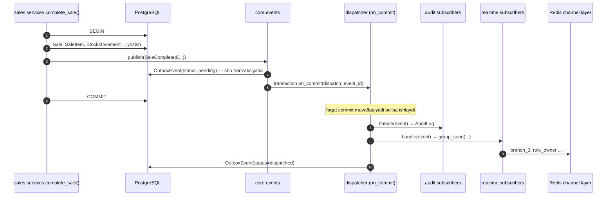

# Domen hodisalari

> Holat: mexanizm va accounts/branches/core hodisalari 1-bosqichda amalga oshirildi; qolgan jadvallar reja.

## 1. Mexanizm



- `core.events.publish(event)` **faqat** `transaction.atomic` ichidan chaqiriladi (tashqarida chaqirilsa xato).
- Hodisa avval `core.OutboxEvent` jadvaliga yoziladi (shu tranzaksiyada), keyin `transaction.on_commit` ichida obunachilarga tarqatiladi.
  Rollback bo'lsa — outbox yozuvi ham, hodisa ham bo'lmaydi. Commit dan keyin jarayon o'lib qolsa — `core.tasks.redispatch_outbox` (Celery, har daqiqa) `pending` yozuvlarni qayta tarqatadi.
- Obunachi `@subscribe("sale.completed")` dekoratori bilan ro'yxatga olinadi, har app ning `subscribers.py` fayli `AppConfig.ready()` da yuklanadi.
- Obunachi xatosi boshqa obunachilarga va asosiy so'rovga ta'sir qilmaydi: log + outbox da `attempts` oshadi.
- Og'ir ish (PDF, email, tashqi API) obunachida bajarilmaydi — obunachi Celery vazifasini chaqiradi.
- Hodisa ob'ekti — `frozen dataclass`, payload JSON ga aylantiriladi (Decimal → satr, datetime → ISO).

```python
@dataclass(frozen=True, kw_only=True)
class Event:
    name: ClassVar[str]
    occurred_at: datetime
    actor_id: int | None
    branch_id: int | None
    aggregate_type: str
    aggregate_id: int

@dataclass(frozen=True, kw_only=True)
class SaleCompleted(Event):
    name = "sale.completed"
    sale_id: int
    number: str
    customer_id: int | None
    total: Decimal
    currency: str
    total_base: Decimal
    debt_amount: Decimal
    items: list[dict]   # [{product_id, quantity, unit_price, cost_base}]
```

Nomlash: `<aggregat>.<o'tgan zamon fe'l>`, kichik harf, nuqta bilan.

## 2. Hodisalar ro'yxati

Ustunlar: **Audit** — audit jurnaliga yoziladimi; **WS** — WebSocket ga chiqadimi (guruhlar [realtime.md](realtime.md) da); **Boshqa** — boshqa obunachilar.

### accounts

| Hodisa | Qachon | Payload | Audit | WS | Boshqa |
|---|---|---|---|---|---|
| `user.logged_in` | muvaffaqiyatli login | user_id, ip, user_agent | ✔ | — | — |
| `user.login_failed` | noto'g'ri parol | username, ip | ✔ | — | throttle hisoblagichi |
| `user.created` / `user.updated` / `user.deactivated` | admin amali | user_id, username, changes {maydon: {old, new}} | ✔ | — | `user.deactivated` → realtime shu user sessiyalarini yopadi (2-bosqich) |
| `user.password_changed` | o'zi yoki admin parolni almashtirdi | user_id, by_self | ✔ | — | |
| `role.created` / `role.updated` / `role.deleted` | rol boshqaruvi | role_id, code, capabilities / changes | ✔ | — | |
| `setting.changed` (core) | tizim sozlamasi o'zgardi | key, old_value, new_value | ✔ | — | kesh tozalanadi |
| `system.notice` (realtime) | rahbar hammaga xabar yubordi | level, message | ✔ | ✔ `broadcast` | |

### branches / catalog / currency

| Hodisa | Qachon | Payload | Audit | WS | Boshqa |
|---|---|---|---|---|---|
| `branch.created` / `branch.updated` | | branch_id, code, branch_name, type / changes | ✔ | — | |
| `category.created` / `category.updated` | | category_id, category_name, parent_id / changes | ✔ | — | |
| `unit.saved` / `price_type.saved` | ma'lumotnoma yaratildi/o'zgardi | id, code, changes | ✔ | — | |
| `product.created` / `product.updated` | | product_id, sku, product_name / changes {maydon: {old, new}} | ✔ | — | |
| `product.price_changed` | yangi narx qatori | product_id, price_type, currency, old_amount, new_amount; branch_id (meta) | ✔ | — | |
| `currency.created` / `currency.updated` | valyuta jadvali o'zgardi | currency_id, code / changes | ✔ | — | |
| `currency.rate_updated` | Celery (`currency.fetch_rates`) yoki qo'lda kiritildi | rates: [{currency, rate, date}], source (`cbu` / `manual`) | ✔ | ✔ `broadcast` | frontend: valyuta va tovar keshlari + toast |

### purchasing

| Hodisa | Qachon | Payload | Audit | WS | Boshqa |
|---|---|---|---|---|---|
| `supplier.saved` | yetkazib beruvchi yaratildi/o'zgardi | supplier_id, supplier_name, created, changes | ✔ | — | 4 ✅ |
| `expense_type.saved` | xarajat turi yaratildi/o'zgardi | expense_type_id, code, changes | ✔ | — | 4 ✅ |
| `purchase.created` | kirim qoralamasi yaratildi | purchase_id, number, supplier_id; branch_id (meta) | ✔ | — | 4 ✅ |
| `purchase.received` | kirim tasdiqlandi (tovar omborga kirdi) | purchase_id, number, supplier_id, currency, rate_to_base, subtotal, expenses_total_base, total_base, items [{product_id, quantity, landed_unit_cost_base}]; branch_id (meta) | ✔ | — | 4 ✅. **inventory** emas! kirim service i `inventory.services.receive_stock()` ni to'g'ridan-to'g'ri chaqiradi (bir tranzaksiyada bo'lishi shart), hodisa faqat xabar uchun |
| `purchase.cancelled` | qoralama yoki tasdiqlangan kirim bekor qilindi | purchase_id, number, previous_status, reason | ✔ | — | 4 ✅ |

### inventory

| Hodisa | Qachon | Payload | Audit | WS | Boshqa |
|---|---|---|---|---|---|
| `stock.changed` | har qanday qoldiq o'zgarishi (kirim, kirim bekor qilish; keyin savdo, qaytarish, ko'chirish, inventarizatsiya, hisobdan chiqarish) | branch_id, product_id, quantity_before, quantity_after, delta, movement_type, document_type, document_id, document_number | — (`audit=False`: harakat jurnali o'zi tarix) | ✔ `branch_{id}` (tannarxsiz) | 4 ✅ (kirim); `stock.below_minimum` tekshiruvi shu joyda |
| `stock.below_minimum` | qoldiq kamayib minimaldan **pastga o'tganda** (har chiqimda emas: `StockLevel.below_minimum` bayrog'i bilan) | branch_id, product_id, product_name, quantity, min_quantity, unit | ✔ | ✔ `branch_{id}` | 4 ✅. Minimal: nuqta bo'yicha → tovar → sozlama `inventory.default_min_quantity` |
| `stock.min_quantity_changed` | nuqta bo'yicha minimal qoldiq o'zgartirildi | product_id, old_value, new_value; branch_id (meta) | ✔ | — | 4 ✅ |
| `transfer.sent` | ko'chirish jo'natildi | transfer_id, number, from_branch_id, to_branch_id, items_count | ✔ | ✔ `branch_{to}` | |
| `transfer.received` | qabul qilindi (qisman farq bilan ham) | transfer_id, number, from_branch_id, to_branch_id, has_discrepancy | ✔ | ✔ `branch_{from}`, `branch_{to}` | farq bo'lsa `role_owner` ga ham |
| `transfer.cancelled` | | transfer_id, reason | ✔ | ✔ ikkala nuqta | |
| `stock_count.completed` | inventarizatsiya yakunlandi, farqlar qo'llandi | stock_count_id, branch_id, surplus_count, shortage_count, difference_base | ✔ | — | |
| `write_off.completed` | hisobdan chiqarish | write_off_id, branch_id, reason, total_cost_base | ✔ | — | |

### sales

| Hodisa | Qachon | Payload | Audit | WS | Boshqa |
|---|---|---|---|---|---|
| `sale.completed` | savdo yakunlandi | sale_id, number, seller_id, currency, total, total_base, cost_base, discount_total, items_count, payments [{method, currency, amount}]; branch_id (meta) | ✔ | ✔ `dashboard.updated` — `dashboard.view` huquqi borlarning `user_{id}` guruhlariga | 5 ✅; 6-bosqichda customer_id, debt_amount qo'shiladi |
| `sale.cancelled` | yakunlangan savdo bekor qilindi (`sales.cancel`) | sale_id, number, total, currency, reason | ✔ | ✔ `dashboard.updated` | 5 ✅ |
| `sale_return.completed` | qaytarish yakunlandi | return_id, sale_id, branch_id, total, refund_method | ✔ | ✔ dashboard | |

### payments

| Hodisa | Qachon | Payload | Audit | WS | Boshqa |
|---|---|---|---|---|---|
| `payment.received` | mijozdan to'lov qabul qilindi (savdo paytida; 6-bosqichdan qarz to'lovi ham) | payment_id, number, method, currency, amount, amount_base, is_cash, cashbox_id, document_type, document_id, document_number; branch_id (meta) | ✔ | ✔ `branch_{id}` (buxgalter/rahbar `branches.view_all` orqali hamma nuqtada) | 5 ✅. Qaytim (`kind=change`) alohida hodisa chiqarmaydi — `sale.completed` da |
| `payment.refunded` | mijozga pul qaytarildi (savdo bekor qilinganda) | payment_id, original_payment_id, number, method, currency, amount, is_cash, cashbox_id, document_type, document_id, reason | ✔ | ✔ `branch_{id}` | 5 ✅ |
| `payment_method.saved` | to'lov turi yaratildi/o'zgardi | payment_method_id, code, created, changes | ✔ | — | 5 ✅ |
| `debt.registered` | nasiya yozildi | debt_id, customer_id, sale_id, amount, currency, due_date | ✔ | — | |
| `debt.settled` | qarz to'liq yopildi | debt_id, customer_id | ✔ | — | |
| `debt.overdue` | Celery muddati o'tganini aniqladi | debt_id, customer_id, customer_name, amount_remaining, currency, due_date, days_overdue | ✔ | ✔ `role_accountant` | |
| `customer.credit_limit_warning` | qarz limitning N% dan oshdi | customer_id, used_base, limit_base, percent | ✔ | ✔ `role_accountant` | |
| `cash_shift.opened` / `cash_shift.closed` | kassa smenasi | shift_id, cashbox_id, user_id, expected, actual, difference | ✔ | — | |

### reports

| Hodisa | Qachon | Payload | Audit | WS | Boshqa |
|---|---|---|---|---|---|
| `report.ready` | Celery hisobot faylini tayyorladi | job_id, report_key, format, download_url | — | ✔ `user_{id}` | |
| `report.failed` | | job_id, error | — | ✔ `user_{id}` | |

## 3. Hodisa ↔ WebSocket xabari

Hodisa nomi va WS xabar turi **bir xil** (`stock.changed` → `{type: "stock.changed"}`), faqat payload WS uchun qisqartiriladi (ichki id lar va narx-tannarx kabi sezgir maydonlar olib tashlanadi, masalan sotuvchi `cost_base` ni ko'rmaydi).
Istisno: `sale.completed`/`sale.cancelled`/`sale_return.completed` rahbar ekranida `dashboard.updated` bo'lib chiqadi (ichida nima o'zgargani emas, "dashboardni yangila" signali).

## 4. Audit jurnali

`audit.subscribers` barcha `Audit ✔` hodisalarga obuna bo'ladi va `AuditLog` ga yozadi:
`actor_id, branch_id, event_name, aggregate_type, aggregate_id, payload (JSON), ip, user_agent, request_id, created_at`.
`ip`/`user_agent`/`request_id` `core.context` (contextvars, middleware o'rnatadi) dan olinadi; Celery ichida bo'sh.
Audit jadvali faqat qo'shiladi (`INSERT`), o'zgartirish va o'chirish yo'q.
