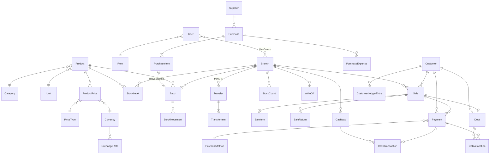
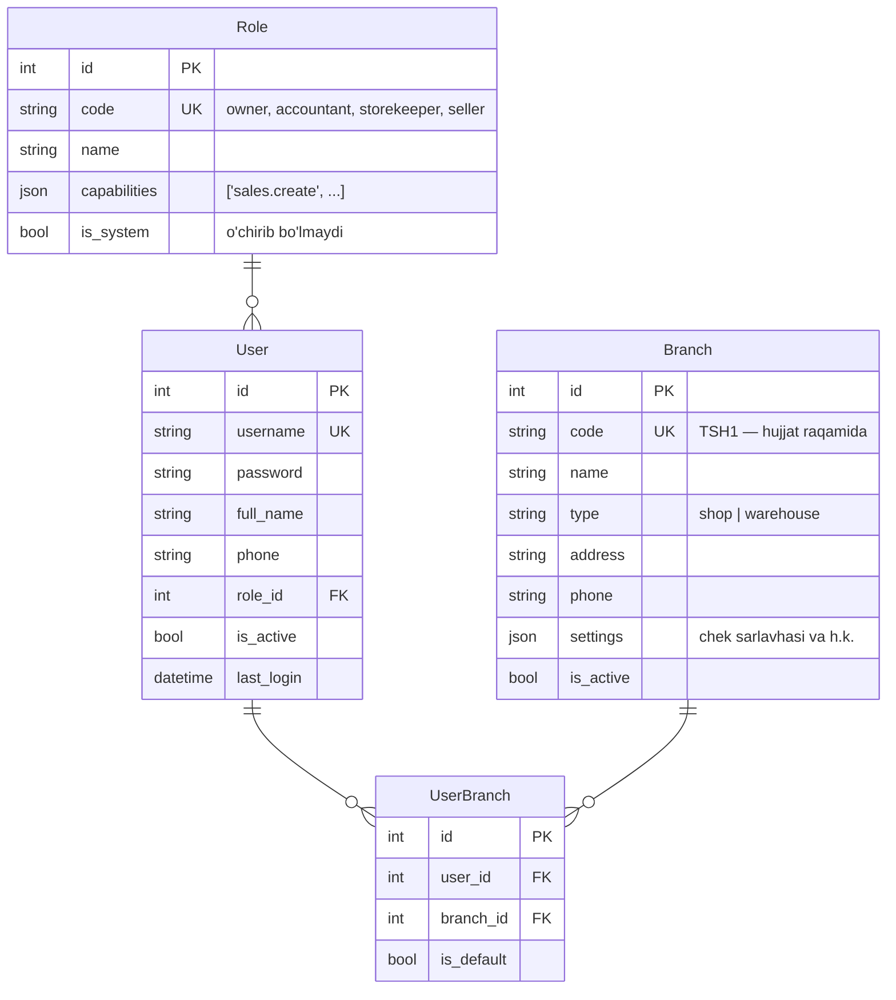
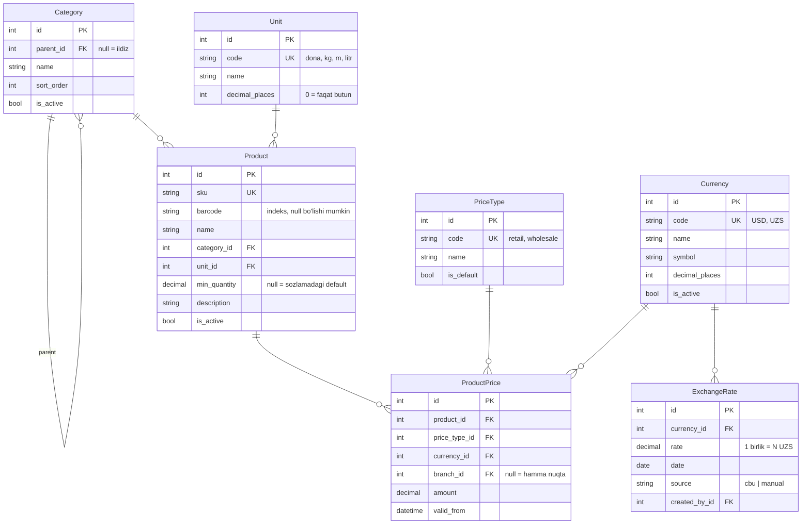
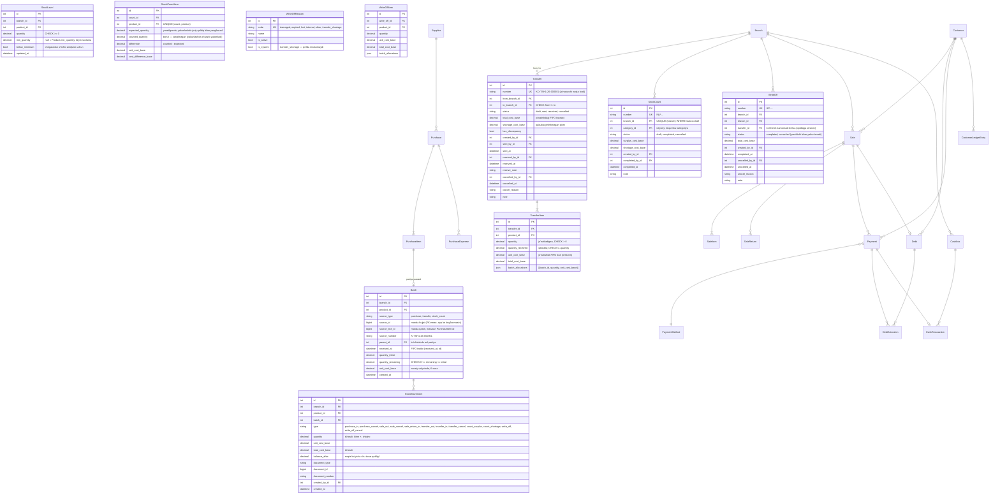
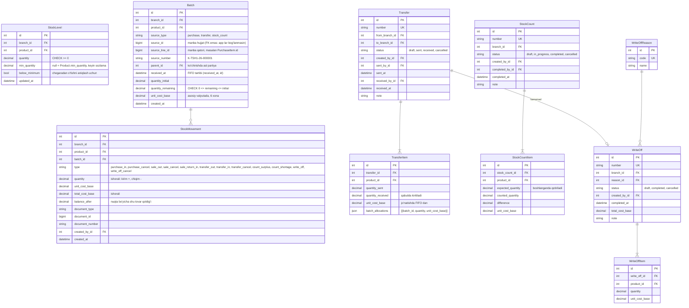
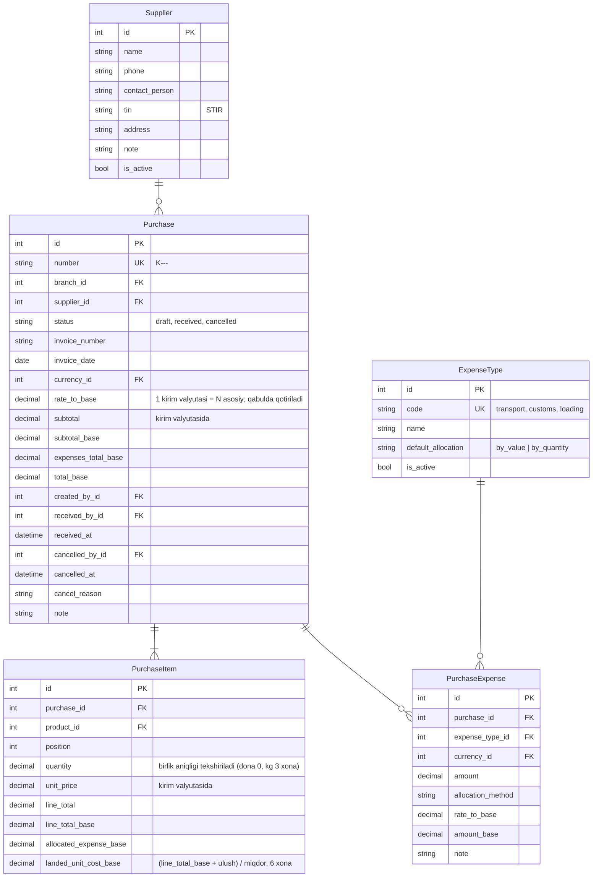
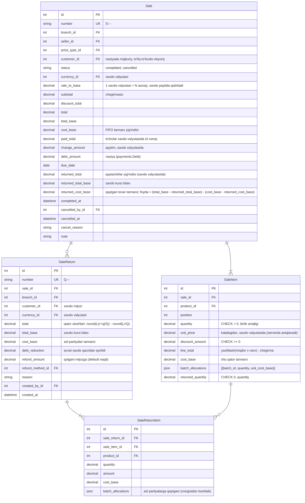
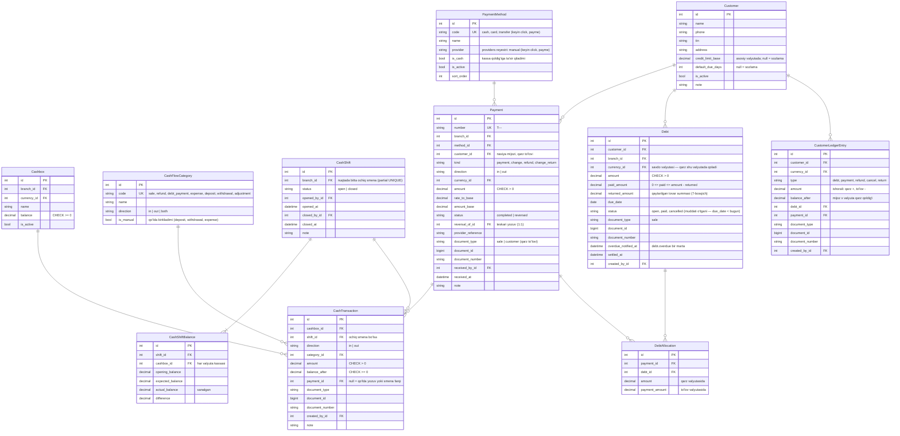
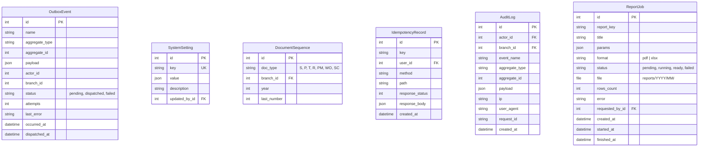

# ER-diagramma

> Holat: 0-bosqich — reja. Maydon nomlari kodlashda sal o'zgarishi mumkin, lekin jadvallar va bog'lanishlar shu.

Umumiy kelishuvlar:

- Har jadvalda `id` (BigAutoField), `created_at`, `updated_at` (diagrammada ko'rsatilmagan).
- Pul: `decimal(20,4)`, kurs: `decimal(20,6)`, miqdor: `decimal(14,3)`.
- `*_base` — asosiy hisob valyutasidagi summa (sozlama `currency.base_code`, hozir USD).
- Moliyaviy hujjatlar `number` ga ega: `S-TSH1-26-000123` (tur-nuqta kodi-yil-tartib), `DocumentSequence` dan.
- Hujjatlar o'chirilmaydi, `status` orqali bekor qilinadi.

## 1. Umumiy ko'rinish (asosiy jadvallar)

## 2. accounts, branches

- `UserBranch` bo'sh + rolda `branches.view_all` → barcha nuqtalar (rahbar, buxgalter).
- Sotuvchi/omborchi kamida bitta `UserBranch` ga ega bo'lishi shart.

## 3. catalog, currency

- `ProductPrice` — faqat qo'shiladi (tarix): amaldagi narx — eng so'nggi `valid_from <= now`; nuqtaga xos narx (`branch` to'ldirilgan) umumiy narxdan (`branch = null`) ustun. Indeks `(product, price_type, currency, branch, -valid_from)`.
- `ExchangeRate` da `UNIQUE (currency, date)` — kuniga bitta kurs; qo'lda kiritilgan kurs shu kungi CBU kursini almashtiradi (`source` qaysi manbadan ekanini saqlaydi). Kurs 6 xonagacha. UZS uchun kurs yozilmaydi (1).
- `Product.barcode` — bo'sh bo'lishi mumkin, to'ldirilganlari `UNIQUE` (qisman indeks); `sku` katta harfga keltiriladi.
- `Category` da `UNIQUE (parent, name)` (ildizlar uchun ham — `NULLS NOT DISTINCT`); sikl service da tekshiriladi.
- Seed: valyutalar USD (2 xona), UZS (0 xona); birliklar dona, kg, g, l, m, m2, qadoq; narx turlari Chakana (default), Ulgurji. Hammasi MB da, admin/API orqali o'zgaradi.
- 3-bosqichda amalga oshirildi; rejadan farq: `Currency.sort_order`, `PriceType.sort_order`, `Unit.is_active` qo'shildi.

## 4. inventory

## 2. accounts, branches

- `UserBranch` bo'sh + rolda `branches.view_all` → barcha nuqtalar (rahbar, buxgalter).
- Sotuvchi/omborchi kamida bitta `UserBranch` ga ega bo'lishi shart.

## 3. catalog, currency

- `ProductPrice` — faqat qo'shiladi (tarix): amaldagi narx — eng so'nggi `valid_from <= now`; nuqtaga xos narx (`branch` to'ldirilgan) umumiy narxdan (`branch = null`) ustun. Indeks `(product, price_type, currency, branch, -valid_from)`.
- `ExchangeRate` da `UNIQUE (currency, date)` — kuniga bitta kurs; qo'lda kiritilgan kurs shu kungi CBU kursini almashtiradi (`source` qaysi manbadan ekanini saqlaydi). Kurs 6 xonagacha. UZS uchun kurs yozilmaydi (1).
- `Product.barcode` — bo'sh bo'lishi mumkin, to'ldirilganlari `UNIQUE` (qisman indeks); `sku` katta harfga keltiriladi.
- `Category` da `UNIQUE (parent, name)` (ildizlar uchun ham — `NULLS NOT DISTINCT`); sikl service da tekshiriladi.
- Seed: valyutalar USD (2 xona), UZS (0 xona); birliklar dona, kg, g, l, m, m2, qadoq; narx turlari Chakana (default), Ulgurji. Hammasi MB da, admin/API orqali o'zgaradi.
- 3-bosqichda amalga oshirildi; rejadan farq: `Currency.sort_order`, `PriceType.sort_order`, `Unit.is_active` qo'shildi.

## 4. inventory

- `StockLevel`: `UNIQUE (branch, product)`, `CHECK (quantity >= 0)`. Manfiy qoldiq **yo'q** (rejadagi `allow_negative_stock` sozlamasi olib tashlandi: FIFO partiyasiz chiqimni tannarxsiz qoldirardi).
- `StockLevel.quantity` doim `SUM(Batch.quantity_remaining)` ga teng — bu invariantni test tekshiradi.
- `StockMovement` — faqat `INSERT`; har qoldiq o'zgarishi bitta qator (chiqim bir nechta partiyadan bo'lsa — har partiyaga bitta qator). Hisobotlar va "tovar kartasi" shu jadvaldan.
- Bir vaqtdagi chiqimlar: avval `StockLevel` keyin partiyalar `SELECT ... FOR UPDATE` bilan qulflanadi (doim shu tartibda — deadlock bo'lmasin).
- `Batch.source_*` — umumiy havola (`GenericForeignKey` emas, oddiy maydonlar): inventory boshqa app modellarini bilmaydi. Bekor qilishda `reverse_receipt(doc_type, doc_id)` shu maydonlar bo'yicha partiyalarni topadi.
- 4-bosqichda: `StockLevel`, `Batch`, `StockMovement`; 7-bosqichda: `Transfer`, `StockCount`, `WriteOff` (+ qatorlar, sabablar).
- Ko'chirish jo'natilganda manbadan FIFO chiqim (`transfer_out`), partiyalar `batch_allocations` ga yoziladi. Qabulda qabul qiluvchi nuqtada har manba partiya uchun yangi `Batch` (`parent` — manba partiya, `source_type=transfer`) asl tannarx bilan. Kam kelgan qism (FIFO tartibida oxirgisi) — "yo'lda yo'qolgan": avtomatik `WriteOff` (sabab `transfer_shortage`, `transfer_id` bilan), tovar kelmagani uchun qoldiq harakati yo'q; rahbarga xabar ketadi. Jo'natilgan ko'chirish bekor qilinsa — tovar manbadagi **asl partiyalarga** (`transfer_cancel`).
- Inventarizatsiya yakunlanganda har sanalgan qator joriy qoldiq bilan (qulf ostida) solishtiriladi: ortiqcha — yangi partiya (`count_surplus`, tannarx: shu nuqtadagi oxirgi partiya, bo'lmasa boshqa nuqtadagi, yoki 0), kamomad — FIFO chiqim (`count_shortage`). Sanash paytidagi savdolar shu tariqa hisobga olinadi.
- Hisobdan chiqarish yaratilishi bilan FIFO chiqim (`write_off`); bekor qilish — asl partiyalarga (`write_off_cancel`).

## 5. purchasing

- `draft` → `received` o'tishida: shu kungi kurs qotiriladi, xarajatlar taqsimlanadi (`distribute` — 0,0001 gacha pastga yaxlitlab, qoldiq eng katta ulushga: yig'indi doim aniq), `landed_unit_cost_base` hisoblanadi, `inventory.services.receive_stock()` har qator uchun `Batch` yaratadi, `purchase.received` hodisasi. Takroriy so'rov `Idempotency-Key` bilan bir marta bajariladi.
- `draft` → `cancelled` doim; `received` → `cancelled` faqat partiyalardan hali hech narsa chiqmagan bo'lsa (`quantity_remaining == quantity_initial`), aks holda 409 `batch_consumed`. Bekor qilishda `purchase_cancel` harakatlari yoziladi.
- Kurs yo'q bo'lsa (kirim yoki xarajat valyutasi uchun) oldindan hisob ham, qabul ham 409 `rate_unavailable`.
- Seed: xarajat turlari Transport (qiymat bo'yicha), Bojxona (qiymat bo'yicha), Yuklash-tushirish (miqdor bo'yicha).
- Yetkazib beruvchiga qarz/to'lov hisobi MVP da yo'q, keyin `SupplierPayment` qo'shilishi uchun joy qoldirilgan (`payments` da `direction` va `counterparty_type` maydonlari).

## 6. sales

- 5–6-bosqichda amalga oshirildi: `Sale` (+ `customer_id`, `debt_amount`, `due_date`), `SaleItem`. Qaytarish (`SaleReturn`) — 7-bosqich.
- Nasiya: to'lov jamidan kam bo'lsa va mijoz tanlangan bo'lsa qolgani `payments.services.register_debt()` bilan qarz bo'ladi (`sales.credit` huquqi, kredit limiti — oshsa 409 `credit_limit_exceeded`, tovar chiqimidan oldin tekshiriladi). Qarz kasr qoldig'i yuqoriga yaxlitlanadi; muddat — kiritilgan (bugundan oldin emas) yoki mijoz/sozlama defaulti.
- Savdo bitta so'rovda va bitta tranzaksiyada yakunlanadi: narx (katalog; savdo valyutasida bo'lmasa — sozlama ruxsat bersa — joriy kurs bilan o'tkaziladi) → chegirma tekshiruvi → FIFO chiqim (`inventory.services.issue_stock`, tovar id tartibida qulflanadi) → to'lovlar (`payments.services.receive_payment`) → qaytim (`give_change`, faqat naqd) → `sale.completed`.
- Narxni server belgilaydi (kassir narxni o'zgartira olmaydi). Mijoz ekrandagi jamini `expected_total` sifatida yuboradi; farq bo'lsa 409 `total_mismatch` (narx o'zgargan).
- Bekor qilish (`sales.cancel`): nasiya bekor qilinadi (to'lov qilingan bo'lsa 409 `debt_has_payments`), tovar **asl partiyalarga** qaytadi (`inventory.services.restore_stock`, `sale_cancel` harakati, tannarx saqlanadi), to'lovlar teskari yoziladi (`payments.services.reverse_document_payments`). Kassada naqd yetmasa — 409 `insufficient_cash`.

## 7. payments

- 5–6-bosqichda amalga oshirildi. Rejadan farqlar: `Payment` da `sale_id` o'rniga umumiy `document_type/document_id/document_number` (payments savdoni bilmaydi — bog'liqlik yo'nalishi sales → payments); `kind` va `reversal_of` (teskari yozuvlar); `Debt.status` da `partially_paid`/`overdue` yo'q — qisman to'langani `paid_amount > 0`, muddati o'tgani `due_date < bugun` dan hisoblanadi; smena **nuqta** bo'yicha (barcha valyutalar bitta smenada, qoldiqlar `CashShiftBalance` da).
- Kassa: har nuqta × valyuta uchun alohida `Cashbox`, birinchi naqd harakatda avtomatik yaratiladi. Faqat `PaymentMethod.is_cash=true` to'lovlar kassa qoldig'ini o'zgartiradi. Qaytim ham `Payment` (`kind=change`, naqd, `out`).
- Nasiya: `register_debt` mijoz qatorini qulflaydi (`select_for_update`) — bir mijozga parallel nasiyalar limitni chetlab o'tolmaydi. Limit asosiy valyutada; ochiq qarzlar **joriy kurs** bilan yig'iladi. Limit sozlamasi: mijozda yoki `payments.default_credit_limit_base` (default 0 — nasiya yo'q).
- Qarz to'lovi FIFO: eng eski muddatdan boshlab yopiladi (yoki tanlangan qarzlar), boshqa valyutadagi to'lov to'lov paytidagi kurs bilan o'tkaziladi; qarzdan ortiq summa rad etiladi (to'lov valyutasining bitta eng kichik birligidan kam yaxlitlash qoldig'i e'tiborsiz). To'liq yopish summasi — `GET customers/<id>/payoff/?currency=`.
- Qarz to'lovini qaytarish (`payments.refund`): qarzlar qayta ochiladi, mijoz hisobiga `refund` yozuvi, naqd bo'lsa kassadan chiqim. Savdo to'lovi — faqat savdoni bekor qilish orqali.
- Tovar qaytarish (7-bosqich): summa avval savdo qarzidan ayiriladi (`Debt.returned_amount`, mijoz hisobiga `return` yozuvi, qoldiq 0 bo'lsa qarz yopiladi), qolgani `refund_to_customer` bilan mijozga (default naqd, kassadan; `Payment.kind=refund`, `reversal_of` bo'sh, hujjat — `sale_return`). Qarz qoldig'i hamma joyda `amount - paid_amount - returned_amount`.
- Smena yopilganda sanalgan va kutilgan farqi `adjustment` kassa yozuvi bilan tenglashtiriladi — tizimdagi qoldiq doim haqiqiy naqdga teng. Sozlama `cashbox.require_open_shift=true` bo'lsa naqd harakat faqat ochiq smenada.

## 8. core, audit, reports

- `IdempotencyRecord`: `UNIQUE (key, user_id)`; 24 soatdan keyin tozalanadi.
- `DocumentSequence`: `UNIQUE (doc_type, branch_id, year)`.
