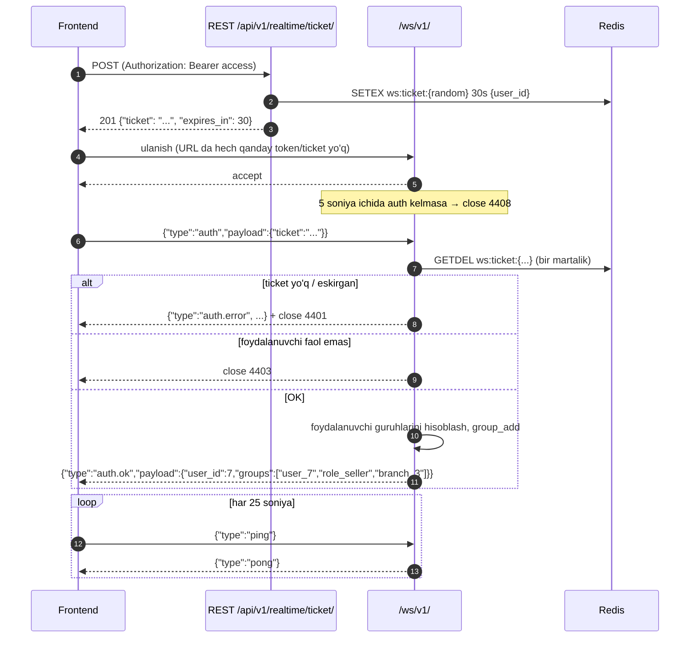

# Real vaqt (WebSocket)

> Holat: 2-bosqich amalga oshirildi — `apps/realtime` (consumer, ticket, guruhlar, router, notice API)
> va frontend `shared/realtime` (RealtimeClient, invalidate xaritasi, indikator, polling).
> Keyingi bosqichlar faqat `router.route(...)` qatorlari va `invalidationRules` yozuvlarini qo'shadi.
>
> Kod joylari: backend `apps/realtime/{consumers,tickets,router,subscribers}.py`,
> `config/asgi.py` (OriginValidator, `REALTIME_ALLOWED_ORIGINS`); frontend
> `src/shared/realtime/{client,invalidation,store,api}.ts`, `src/app/providers/RealtimeProvider.tsx`.

## 1. Prinsip

WebSocket — **faqat bildirishnoma kanali**. Ma'lumot manbai doimo REST + PostgreSQL.
Xabar kelganda frontend tegishli TanStack Query keshini `invalidate` qiladi va REST dan qayta o'qiydi.
Ulanish uzilsa tizim ishlashda davom etadi (faqat jonli yangilanish to'xtaydi, polling yoqiladi).

## 2. Ulanish va autentifikatsiya



- Ticket: 32 bayt `secrets.token_urlsafe`, Redis da 30 soniya, **bir marta** ishlatiladi (`GETDEL` atomar), foydalanuvchi id ga bog'langan.
- Ticket URL ga ham, sarlavhaga ham yozilmaydi — birinchi xabarda keladi. Shuning uchun loglarda/proxy tarixida qolmaydi.
- Auth dan oldin kelgan boshqa har qanday xabar → close 4401.
- Bir foydalanuvchi bir nechta ulanish ochishi mumkin (ikki tab, telefon + kompyuter).
- Foydalanuvchi o'chirilsa (`user.deactivated`) yoki roli/nuqtasi o'zgarsa (`user.updated`) → `user_{id}` guruhiga `session.revoked` yuboriladi va server ulanishni 4403 bilan yopadi; frontend qayta ticket oladi (yangi huquqlar bilan) yoki login sahifasiga o'tadi.
- Access token eskirishi WS ga ta'sir qilmaydi (ulanish ticket paytida tekshirilgan); uzoq ulanishlar uchun server har 15 daqiqada foydalanuvchi hali faolligini tekshiradi.

### Yopish kodlari

| Kod | Ma'nosi | Frontend harakati |
|---|---|---|
| 1000 | oddiy yopish (logout) | qayta ulanmaydi |
| 1001 / 1006 | server qayta ishga tushdi, tarmoq uzildi | backoff bilan qayta ulanadi |
| 4401 | autentifikatsiya yo'q / ticket yaroqsiz | yangi ticket olib qayta ulanadi; REST ham 401 bersa → login |
| 4403 | ruxsat yo'q / foydalanuvchi faol emas | `me` ni qayta o'qiydi, kerak bo'lsa login |
| 4408 | auth kutish vaqti tugadi | darhol qayta ulanadi |
| 4429 | juda ko'p ulanish (bitta userga > 10) | 30 soniyadan keyin |

## 3. Guruhlar (rooms)

Guruhlarga a'zolikni **server** hal qiladi, mijoz "obuna bo'laman" deb so'ramaydi — shu bilan huquqsiz obuna imkonsiz.

| Guruh | Kim a'zo | Nima keladi |
|---|---|---|
| `user_{id}` | shu foydalanuvchi (barcha ulanishlari) | `report.ready`, `session.revoked` (o'chirildi, rol/nuqta/parol o'zgardi), shaxsiy bildirishnomalar |
| `role_{code}` | shu roldagi hamma (`role_owner`, `role_accountant`, `role_storekeeper`, `role_seller`) | rol huquqlari o'zgarsa `session.revoked`. Bildirishnomalar (`dashboard.updated`, `debt.overdue`, `customer.credit_limit_warning`) rol nomiga emas, **huquq** bo'yicha `user_{id}` guruhlariga yuboriladi — rollar MB da o'zgaradi |
| `branch_{id}` | `UserBranch` orqali shu nuqtaga biriktirilganlar; `branches.view_all` huquqi borlar **barcha** faol nuqtalarga | `stock.changed`, `stock.below_minimum`, `transfer.*` |
| `broadcast` | hamma autentifikatsiyadan o'tganlar | `currency.rate_updated`, `system.notice` |

Guruhlar `auth` paytida `accounts.selectors` orqali hisoblanadi (`get_realtime_groups(user)`), ro'yxat `auth.ok` da qaytariladi (debug uchun qulay).

## 4. Xabar formati

Barcha xabarlar (ikkala yo'nalishda) bir xil konvert:

```json
{
  "id": "5f0c2d7e9b1a4c3e8d6f0a1b2c3d4e5f",
  "type": "stock.changed",
  "payload": { "...": "..." },
  "timestamp": "2026-10-22T14:03:11.512+05:00"
}
```

- `id` — xabar identifikatori (7-bosqichdan). Bitta marshrut xabari bir nechta guruhga yuboriladi (masalan ko'chirish — ikkala nuqtaga); ikkala guruhda bo'lgan foydalanuvchi (rahbar) uni ikki marta oladi — mijoz `id` bo'yicha takrorni tashlab yuboradi (oxirgi 200 ta id).
- `type` — hodisa nomi bilan bir xil (`<aggregat>.<fe'l>`), kichik harf.
- `payload` — faqat identifikatorlar va ekranni yangilash uchun yetarli minimal maydonlar. To'liq ma'lumot REST dan olinadi.
- `timestamp` — server vaqti, ISO 8601, `Asia/Tashkent`.
- Sezgir maydonlar (tannarx, foyda) WS payload ida **yo'q**: `branch_{id}` guruhida sotuvchi ham bor.

## 5. Xabar turlari

### Mijoz → server

| `type` | `payload` | Izoh |
|---|---|---|
| `auth` | `{ticket}` | ulanishdan keyin 5 s ichida, bir marta |
| `ping` | `{}` | har 25 s; 2 ta `pong` kelmasa mijoz ulanishni qayta ochadi |

Boshqa hech qanday mijoz xabari qabul qilinmaydi (noma'lum `type` → e'tiborsiz, log).

### Server → mijoz

| `type` | Guruh | `payload` | Frontend: qaysi kesh invalidate | Bosqich |
|---|---|---|---|---|
| `auth.ok` | ulanish | `{user_id, groups: []}` | — | 2 |
| `auth.error` | ulanish | `{code, message}` | — (keyin close) | 2 |
| `pong` | ulanish | `{}` | — | 2 |
| `session.revoked` | `user_{id}` / `role_{code}` | `{reason: "deactivated" \| "permissions_changed" \| "password_changed"}` — keyin server 4403 bilan yopadi | `deactivated` → logout; aks holda `me` qayta o'qiladi, yangi ticket bilan qayta ulanadi | 2 ✅ |
| `system.notice` | `broadcast` | `{level: "info" \| "warning" \| "error", message}` (`POST /api/v1/realtime/notice/`, `settings.manage`) | — (toast) | 2 ✅ |
| `currency.rate_updated` | `broadcast` | `{rates: [{currency, rate, date}], source}` | `['currency']`, `['products']` + toast "USD = 12 650,45 so'm" | 3 ✅ |
| `stock.changed` | `branch_{id}` | `{branch_id, product_id, quantity, delta, movement_type, document: {type, id, number}}` — tannarx yo'q | `['inventory']`, `['sales','pos']` (kassa qidiruvidagi qoldiq; debounce 1,5 s) | 4 ✅ (kirim), 5 ✅ (savdo, bekor qilish) |
| `stock.below_minimum` | `branch_{id}` (omborchi, sotuvchi; rahbar `branches.view_all` orqali barcha nuqtalar guruhida) | `{branch_id, product_id, product_name, quantity, min_quantity, unit}` | `['inventory']` + ogohlantirish toast "Kam qoldi: …" | 4 ✅ |
| `dashboard.updated` | `dashboard.view` huquqi borlarning `user_{id}` guruhlari (rollar MB da o'zgaradi — rol nomi emas, huquq) | `{branch_id, reason: "sale.completed" \| "sale.cancelled" \| "payment.received" \| "sale_return.completed"}` | `['sales','summary']`, `['sales','list']`, `['dashboard']` (debounce 2 s) — rahbar dashboardi KPI va grafiklarni qayta so'raydi | 5 ✅, 8 ✅ |
| `payment.received` | `branch_{id}` | `{branch_id, payment_id, method, currency, amount, is_cash, cashbox_id, customer_id, document: {type, id}}` | `['payments']` (kassa, jurnal, mijoz kartasi, qarzlar), `['sales','list']`, `['sales','summary']` (debounce 1 s) | 5–6 ✅ |
| `debt.changed` | `branch_{id}` | `{branch_id, debt_id, customer_id}` (nasiya yozildi, yopildi, bekor qilindi) | `['payments']`, `['sales','list']` (debounce 1 s) | 6 ✅ |
| `cash.updated` | `branch_{id}` | `{branch_id, reason: "shift_opened" \| "shift_closed" \| "manual_entry"}` | `['payments']` (debounce 0,5 s) | 6 ✅ |
| `payment.refunded` | `branch_{id}` | xuddi shunday | xuddi shunday | 5 ✅ |
| `debt.overdue` | `debts.manage` huquqi borlar (`user_{id}`) | `{branch_id, debt_id, customer_id, customer_name, amount_remaining, currency, due_date, days_overdue}` | `['payments']` + ogohlantirish toast | 6 ✅ |
| `customer.credit_limit_warning` | `debts.manage` huquqi borlar | `{customer_id, customer_name, used_base, limit_base, percent, base_currency}` | `['payments','customer', id]` + toast | 6 ✅ |
| `debt.changed` (`debt.reduced`) | `branch_{id}` | `{branch_id, debt_id, customer_id}` — tovar qaytarilib qarz kamaydi | `['payments']`, `['sales','list']` | 7 ✅ |
| `transfer.sent` | `branch_{from}` + `branch_{to}` (bitta xabar) | `{transfer_id, number, status, from_branch_id, from_branch_name, to_branch_id, to_branch_name, items_count, actor_id}` — tannarxsiz | `['inventory']` (ro'yxat, hujjat, menyudagi "kutilmoqda" nishoni) + toast **qabul qiluvchi** nuqta omborchisiga (`inventory.transfers.receive`, o'zi jo'natgan bo'lsa yo'q) | 7 ✅ |
| `transfer.received` | ikkala nuqta; farq bo'lsa `dashboard.view` huquqi borlar ham (o'sha xabar) | `{..., status, has_discrepancy, discrepancies: [{product_name, quantity, quantity_received}]}` | `['inventory']` + jo'natuvchiga toast (farq bo'lsa — ogohlantirish, rahbarga ham) | 7 ✅ |
| `transfer.cancelled` | jo'natilgan bo'lsa ikkala nuqta, qoralama — `branch_{from}` | `{..., status, previous_status, reason}` | `['inventory']` + qabul qiluvchiga ogohlantirish toast | 7 ✅ |
| `sale_return.completed` | `branch_{id}` (+ `dashboard.updated` `dashboard.view` larga) | `{branch_id, return_id, number, sale_id, customer_id}` | `['sales']`, `['payments']` (debounce 0,5 s) | 7 ✅ |
| `report.ready` | faqat so'ragan `user_{id}` | `{job_id, report_key, title, format, download_url}` | `['reports','jobs']` + toast "Hisobot tayyor" (fayl «Tayyorlangan fayllar» ro'yxatida, yuklab olish REST orqali) | 8 ✅ |
| `report.failed` | faqat so'ragan `user_{id}` | `{job_id, report_key, title, error}` | `['reports','jobs']` + xato toast | 8 ✅ |

Yangi tur qo'shilganda shu jadval yangilanadi; frontend da noma'lum `type` jim e'tiborsiz qoladi (eski mijoz yangi server bilan buzilmaydi).

## 6. Hodisadan xabargacha (backend)

```
domen hodisasi (on_commit) → realtime.subscribers → realtime.router (hodisa → guruhlar + payload qisqartirish)
→ channel_layer.group_send(group, {"type": "notify", "message": {...}})
→ RealtimeConsumer.notify() → self.send_json(message)
```

- `realtime.router` — oddiy jadval: `route("stock.changed", groups=_branch_group, payload=...)`. Yangi hodisa uchun bitta qator qo'shiladi; huquq bo'yicha guruh — `_capability_users("debts.manage")`.
- Celery ichidan chiqqan hodisalar (kurs, muddati o'tgan qarz) ham xuddi shu yo'ldan o'tadi (`channel_layer` Redis orqali, worker dan ham ishlaydi).
- `group_send` `transaction.on_commit` ichida bo'lgani uchun MB ga yozilmagan narsa haqida xabar ketmaydi.

## 7. Frontend tomoni

- Bitta `RealtimeClient` (singleton), `RealtimeProvider` ichida; login dan keyin ochiladi, logout da 1000 bilan yopiladi.
- **Qayta ulanish:** eksponensial backoff `1s, 2s, 4s, ... 30s` + tasodifiy jitter; har urinishda **yangi ticket** olinadi (REST 401 bersa avval refresh).
  Brauzer `online` hodisasi va tab yana ko'ringanda (`visibilitychange`) darhol qayta ulanish.
- **Holat indikatori:** `connecting | online | offline` — sarlavhada kichik nuqta; `offline` 10 s dan oshsa "Jonli yangilanish uzildi, ma'lumotlar vaqti-vaqti bilan yangilanadi" banneri.
- **Polling ga qaytish:** `offline` holatida muhim so'rovlar (`stock`, `dashboard`, `transfers`, `debts`) uchun TanStack `refetchInterval: 30_000` yoqiladi; `online` bo'lganda o'chiriladi va bir marta hammasi invalidate qilinadi (uzilgan vaqtda o'tkazib yuborilgan o'zgarishlar uchun).
- **Invalidate xaritasi** — `shared/realtime/invalidation.ts` da `type → queryKey[]` jadvali (yuqoridagi ustun). Xabar ishlovchilari komponent ichida emas, shu bitta joyda.
- Tez-tez keladigan `stock.changed` / `dashboard.updated` uchun 1–2 s debounce (bir vaqtda 20 ta sotuv → 1 ta qayta o'qish).

## 8. Testlar

Backend (`apps/realtime/tests/`, `WebsocketCommunicator`, ✅):
- ticket siz ulanib `auth` yubormaslik → 4408; auth dan oldin boshqa xabar → 4401; yaroqsiz ticket → `auth.error` + 4401; ticketni ikki marta ishlatish → ikkinchisi 4401; faol bo'lmagan foydalanuvchi → 4403.
- sotuvchi `branch_1` da bo'lsa `branch_2` xabarini **olmaydi**; rahbar ikkalasini oladi.
- hodisa tranzaksiya commit bo'lgandan keyin keladi; rollback bo'lsa kelmaydi.
- `user.deactivated` → `session.revoked` + 4403 (boshqalarga ta'sir yo'q); rol huquqi o'zgarsa `role_{code}` guruhi; ism o'zgarsa jim.
- ulanish limiti (4429) va yopilgach hisob kamayishi; `POST /realtime/notice/` → `broadcast`.
- `currency.rate_updated` (kurs kiritilganda) `broadcast` orqali boshqa foydalanuvchiga yetib keladi (3 ✅, `apps/currency/tests/test_realtime.py`).
- `stock.changed` faqat shu nuqta guruhiga ketadi, payloadda tannarx yo'q (4 ✅, `apps/inventory/tests/test_realtime.py`).
- Savdo: har qator uchun `stock.changed` (nuqta guruhi), `dashboard.updated` faqat `dashboard.view` huquqi borlarga, `payment.received` nuqta guruhiga (5 ✅, `apps/sales/tests/test_realtime.py`).
- Nasiya: `debt.overdue` buxgalter va rahbarga, sotuvchiga emas; `cash.updated` nuqta guruhiga (6 ✅, `apps/payments/tests/test_credit.py`).

Frontend (`src/shared/realtime/*.test.ts`, soxta WebSocket + fake timers, ✅):
- ticket → `auth` birinchi xabar → `auth.ok` → online; `pong` uzatilmaydi; buzuq JSON e'tiborsiz.
- uzilganda backoff (eksponensial, chegarali, jitter) bilan **yangi ticket** olib qayta ulanadi; `auth.ok` dan keyin backoff nolga qaytadi.
- 4401/4408/4403 → kutmasdan; ticket olib bo'lmasa offline + keyinroq.
- ping har 25 s; 2 ta pong kelmasa yopib qayta ochadi; `close()` → 1000, qayta ulanmaydi.
- invalidate xaritasi: noma'lum tur jim; debounce li turlar bir xil kalitlarni yig'adi.

Brauzerda (Playwright, qo'lda): ikki oyna — rahbar `system.notice` yuboradi → sotuvchida darhol toast; rolni o'zgartirish → sotuvchida `me` yangilanadi va qayta ulanadi; o'chirish → sotuvchi login sahifasiga chiqariladi.
